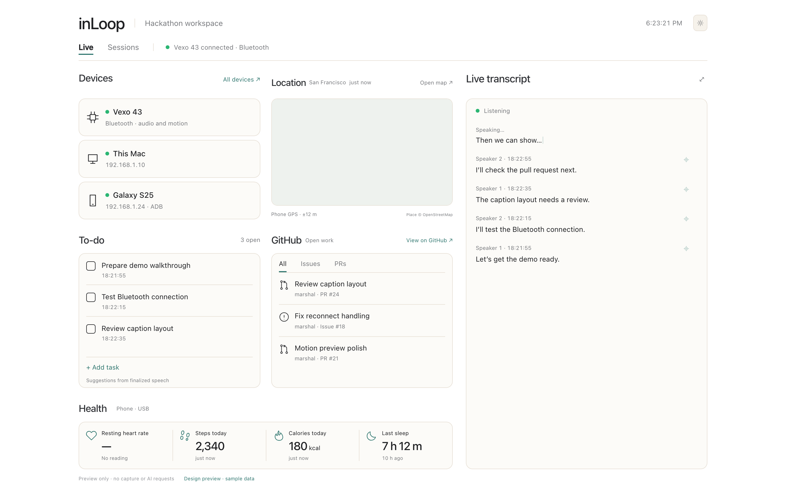
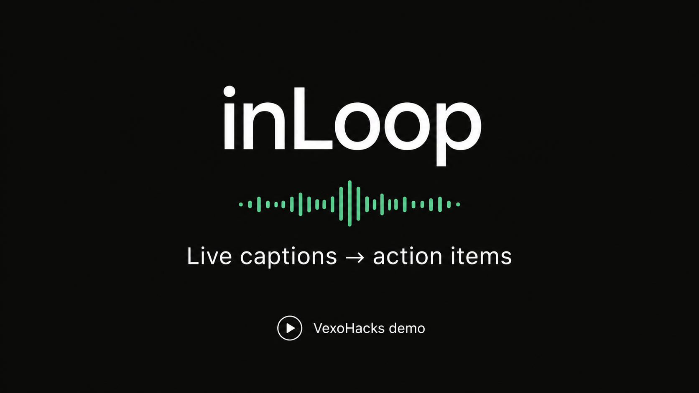
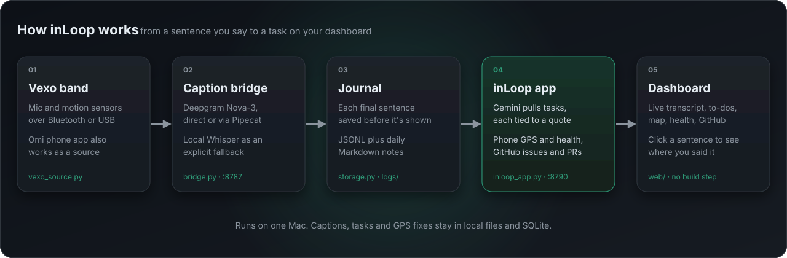

<div align="center">



**A wearable workspace that remembers what you said, what you promised, and where you were.**

[](https://www.python.org/) [](#development) [](https://deepgram.com/) [](https://ai.google.dev/) [](https://www.vexoai.com/hackathon)

<p>
<a href="#demo">Watch demo</a> ·
<a href="#what-a-conversation-looks-like">See it work</a> ·
<a href="#how-it-works">How it works</a> ·
<a href="#quick-start">Quick start</a> ·
<a href="#also-in-this-repo">More features</a>
</p>

</div>

You say "I'll send Sam the deck tomorrow" halfway through a conversation. By dinner it's gone. Notes apps need your hands, and meeting bots need a meeting.

inLoop listens through a Vexo band on your wrist, captions everything you say, and saves it to a local journal. Gemini picks out the promises and requests, and each to-do keeps the exact quote it came from. Every sentence is matched to where you were, using your phone's GPS. Health readings and your open GitHub issues and pull requests sit on the same screen.

Everything runs on one Mac. Captions, tasks and GPS fixes stay in local files and a local SQLite database.

<h2 align="center" id="demo">Demo</h2>

<p align="center">
  <a href="https://youtu.be/6uO9b89b-s0">
    
  </a>
</p>

<p align="center">
  <a href="https://youtu.be/6uO9b89b-s0"><strong>▶ Watch the inLoop demo</strong></a>
</p>

## What a conversation looks like

> **You** (to a teammate): "I'll test the Bluetooth connection."
>
> **Live transcript**, as you speak: *Speaker 2 · 18:22:15 — I'll test the Bluetooth connection.*
>
> **To-do**, a moment later: ☐ **Test Bluetooth connection** · 18:22:15, linked to that sentence and the GPS fix recorded when you said it.

Live inLoop dashboard in dark mode — screenshot supplied from our demo.

## How it works

<p align="center">
  
</p>

1. The Vexo band streams mic audio to the Mac over Bluetooth (USB is the fallback), through the [Vexo open kit](https://github.com/VexoAI-Org/vexo-open-kit). The Omi phone app can be the audio source instead.
2. The caption bridge ([`bridge.py`](bridge.py)) checks the audio and sends it to the selected recognizer: **Deepgram Nova-3**, either directly or through an optional **Pipecat** pipeline, or **local Whisper** on the Mac's GPU. Switching is deliberate. It never silently falls back from cloud to local.
3. Each finished sentence is written to an append-only JSONL journal **before** anything displays it, then copied into readable daily Markdown notes. Raw audio isn't recorded.
4. The inLoop app ([`inloop_app.py`](inloop_app.py)) reads the caption stream and sends new sentences to Gemini in small batches. Gemini returns tasks as strict JSON. A task is only kept if it quotes a real sentence, so made-up tasks are dropped.
5. The dashboard shows the live transcript, to-dos, a satellite map, phone health readings and GitHub work. Choosing a sentence shows the last GPS fix recorded at or before it.

## What it tracks

| Panel | Where it comes from |
| --- | --- |
| **Live transcript** | The caption bridge. Drafts and finished sentences show newest first; scrolling back keeps your place, and "New speech ↑" jumps back to the latest. |
| **To-do** | `gemini-3.5-flash-lite`, reading finished sentences. Each task keeps its owner, its priority (normal or high) and the exact quote. You can add, check off or edit tasks yourself. |
| **Location** | GPS from an Android phone connected over ADB, refreshed every 5 seconds. Shown on Google satellite imagery, in 3D if you add a browser Maps key. |
| **Health** | Health Connect readings from the same phone. Each reading keeps its own measurement time, and missing readings show as unavailable. |
| **GitHub** | Open issues and PRs, read through your `gh` CLI every 2 minutes. Your GitHub credentials never reach the browser. |
| **Devices** | The band's connection and battery, the Mac's LAN IP and the phone's Wi-Fi IP. |
| **Sessions** | Earlier conversations, each exportable as a Markdown file with its transcript, locations and action items. |

## Quick start

You need macOS, standard CPython 3.15 (with the GIL enabled) for the bridge and app, and Python 3.14 for the Vexo input. You also need a Vexo band (band 43 is the one configured) or the Omi phone app, a Deepgram API key, and a Gemini API key for task suggestions.

**1. Clone** with the Vexo SDK submodule:

```bash
git clone --recurse-submodules https://github.com/yhinai/inLoop.git
cd inLoop
```

**2. Add your keys.** Create `.env` from the template, but only on a new install; never overwrite an existing one. Then add:

```bash
cp .env.example .env
```

```bash
DEEPGRAM_API_KEY=your-deepgram-key
OMI_STREAM_TOKEN=choose-a-private-stream-token
GEMINI_API_KEY=your-gemini-key
```

`.env` is gitignored.

**3. Start the caption service.** `./omi start` creates `.venv` with Python 3.15 and the pinned dependencies the first time it runs.

```bash
./omi start
./omi status
```

**4. Connect the band.** Set up `.venv-vexo` with Python 3.14 as described in [Vexo setup](docs/VEXO.md), double-tap the band so it blinks blue, then run:

```bash
./omi source vexo --band 43 --transport ble
```

This runs in the foreground. Ctrl+C turns the mic off and saves what's left. If you're using the Omi phone app instead, connect it as described in [operations](docs/OPERATIONS.md).

**5. Open inLoop.** Point it at the file that holds your Gemini key:

```bash
.venv/bin/python inloop_app.py --gemini-env .env
```

Then open http://127.0.0.1:8790. To look at the interface without any hardware or keys, open http://127.0.0.1:8790/preview.

`./inloop` (or double-clicking `inLoop.command`) starts the same app and opens the browser. It only knows port 8790 and the default Gemini key path, so use the command above if you need either changed.

### Options

| Flag | What it does |
| --- | --- |
| `--gemini-env FILE` | File to read `GEMINI_API_KEY` or `GOOGLE_API_KEY` from. Task suggestions are off until this points at a real key. |
| `--port N` | Serves the app on another port. The default is 8790. |
| `--db FILE` | SQLite file for sessions, tasks and GPS fixes. The default is `logs/inloop-app.sqlite3`. |

| Command | What it does |
| --- | --- |
| `./omi start`, `stop`, `restart` | Manage the caption service. Restarting keeps your history. |
| `./omi status`, `./omi check` | Show the phone, audio, recognizer and saving states; check config and dependencies. |
| `./omi captions` | Open the terminal caption viewer. |
| `./omi backend deepgram` or `whisper` | Switch recognizers, verify the switch, and recover if it fails. |
| `./omi verify --phrase "silver otter carries" --timeout 60` | Say the phrase and confirm it reaches captions and saved notes. |
| `./omi motion` | Live wrist motion view. Add `--control` to drive the Mac pointer. |

## Good to know

- **Cloud speech.** With Deepgram selected, audio from everyone near you goes to Deepgram, so tell people before you start. `./omi backend whisper` keeps recognition on the Mac.
- **What Gemini sees.** Only finished transcript text, in batches of up to 12 sentences, with your existing task titles so it doesn't repeat them. The prompt tells Gemini to treat the transcript as data, not instructions.
- **Where tasks are saved.** In the `tasks` table of `logs/inloop-app.sqlite3`, with each task's title, status, priority, owner, quote, source sentence and creation time. Deleted tasks are flagged, not erased. The whole `logs/` folder is gitignored, so a fresh clone starts empty.
- **Phone data.** The app reads GPS and Health Connect over ADB first. If no phone is connected, it uses a recent snapshot pushed over Tailscale ([`inloop_phone_ingress.py`](inloop_phone_ingress.py)). If neither is available, it falls back to the original author's public telemetry at `alhinai.dev`. Change `TELEMETRY_URL` and `DEVICES_URL` in `inloop_app.py` to use your own.
- **GitHub account.** The search is hard-coded to `involves:yhinai` in `inloop_app.py`. Change it to your username.
- **3D map.** Set `GOOGLE_MAPS_BROWSER_KEY` in `.env` to a browser Maps key allowed for `http://127.0.0.1:8790/*`. Never use your Gemini key here, since a browser key is visible in the page. Without one, the flat satellite map still works.
- **One wearer.** The bridge serves one audio source at a time, and a file lock stops two capture processes from fighting over the band.
- **What's saved.** The journal is the source of truth, and nothing reaches the screen until it's saved there. Drafts aren't saved. If a save fails, the recognized text is retried without decoding the audio again. A full crash can still lose sentences that weren't saved yet.
- **Latency numbers** cover only the Mac and provider stages, not Bluetooth, phone or network delays. See the [optimization audit](docs/OPTIMIZATION.md).

## Project layout

```
inloop_app.py          inLoop web app: tasks, GPS matching, GitHub, phone telemetry
inloop                 launcher for the app (port 8790)
web/                   dashboard (HTML, CSS, JS, Leaflet), no build step
bridge.py              audio ingress, backend choice, saving order, caption fan-out
deepgram_stt.py        Deepgram transport and recovery
pipecat_stt.py         optional Pipecat pipeline (worker in pipecat_worker.py)
stt.py, whisper.py     local Whisper worker on Apple GPU
storage.py             JSONL journal, replay, daily Markdown
vexo_source.py         Vexo band input over Bluetooth or USB
motion*.py             wrist motion view, calibration and Mac pointer control
speakers.py            local voice enrollment and matching
phone_telemetry.py     phone GPS and Health Connect over ADB
tui.py                 terminal caption viewer
cli.py, omi            the ./omi command
scripts/               smoke tests, benchmarks, fault runner, Gemini motion experiments
docs/                  architecture, operations, Vexo, motion, speakers
vendor/vexo-open-kit   Vexo SDK (git submodule, MIT)
tests/
```

## Development

```bash
./omi dev test -q
./omi dev faults
bash -n omi run.sh tui.sh
```

519 tests pass (521 run, 2 skipped). They cover the bridge, both recognizers, the Pipecat path, the journal, the inLoop app, phone telemetry, motion control and calibration, speakers, the CLI and the launcher. They need no microphone, cloud key, model or live connection. The fault runner exercises 8 failure scenarios, and CI runs the tests plus shell syntax and whitespace checks.

Checks against real models are separate and explicit. `./omi dev smoke --backend deepgram` sends test audio to Deepgram on temporary ports. Add `--pipeline pipecat` to go through the Pipecat path. Neither touches the running service.

[Architecture](docs/ARCHITECTURE.md) covers what each part owns and guarantees. [Operations](docs/OPERATIONS.md) covers daily use and recovery. [App details](docs/INLOOP.md) covers the dashboard's data sources.

## Built with

[Vexo](https://www.vexoai.com/) band and [open kit](https://github.com/VexoAI-Org/vexo-open-kit) for audio and motion · [Deepgram](https://deepgram.com/) Nova-3 and [Pipecat](https://github.com/pipecat-ai/pipecat) for speech · [MLX Whisper](https://github.com/ml-explore/mlx-examples) for offline speech · [Gemini](https://ai.google.dev/) for task extraction and motion decisions · [Sherpa-ONNX](https://github.com/k2-fsa/sherpa-onnx) for voice matching · [aiohttp](https://docs.aiohttp.org/) · [Leaflet](https://leafletjs.com/) and Google Maps · [GitHub CLI](https://cli.github.com/)

Built at VexoHacks, Y Combinator, San Francisco, November 14, 2026.

---

## Also in this repo

<details>
<summary><b>Tilt your wrist to drive the Mac pointer</b></summary>

<br>

```bash
./omi motion            # view only: accelerometer, gyro, roll/pitch, built-in gestures
./omi motion --control  # moves the real pointer
```

With `--control`, hold your wrist in a neutral position and press C, tilt right and press X, tilt down and press Y, then press Space to start. Tilting moves the pointer, and returning to neutral stops it. M switches between pointer and scroll, P toggles precision, and +/- changes speed. Enter clicks, and T turns on single-tap clicking. Escape pauses everything, from any app.

The launching terminal needs Accessibility and Input Monitoring permission (System Settings → Privacy & Security). Motion is sampled at 25 Hz alongside captions. How reliable taps are on the wrist hasn't been measured yet. See [MOTION.md](docs/MOTION.md).

</details>

<details>
<summary><b>Gemini Decision 1: recognizing movements from raw sensor data</b></summary>

<br>

`gemini-decision-1` picks from a fixed set of answers instead of writing text. We sent it raw six-axis motion from the band to label movements (swipe, circle, still, tilting, rotating, back and forth, shaking, impact) and screen direction.

On a small recorded test, the motion data alone got 1 of 6 held-out trials right. Adding four reference strokes from the wearer got 6 of 6, at about 400 ms per call. That's six trials from one session, not a validated gesture classifier. The full write-up is in [GEMINI_DECISION_MOTION.md](docs/GEMINI_DECISION_MOTION.md), and the live preview is in [GEMINI_RAW_LIVE.md](docs/GEMINI_RAW_LIVE.md).

</details>

<details>
<summary><b>Telling your voice apart from other speakers</b></summary>

<br>

Deepgram diarization numbers each speaker. Local voice verification compares speech with a profile you enroll on purpose, so it never assumes Speaker 0 is you. It runs on the CPU with Sherpa-ONNX in its own Python 3.14 environment.

```dotenv
OMI_DEEPGRAM_DIARIZE=true
OMI_VOICE_IDENTIFICATION=true
OMI_DEEPGRAM_KEYTERMS='["Vexo","Pipecat"]'
```

Setup and enrollment are in [SPEAKERS.md](docs/SPEAKERS.md).

</details>

<details>
<summary><b>Terminal captions and offline Whisper</b></summary>

<br>

`./omi captions` opens a terminal viewer with search, selection and bookmarks. Closing it leaves transcription running.

`./omi backend whisper` switches to a prewarmed MLX Whisper model on the Mac's GPU, in its own Python 3.14 process, so no audio leaves the laptop. Install `requirements-whisper.txt` and the local models first; see [operations](docs/OPERATIONS.md). Each spoken turn is capped at 8 seconds, so a word can occasionally get split.

</details>
